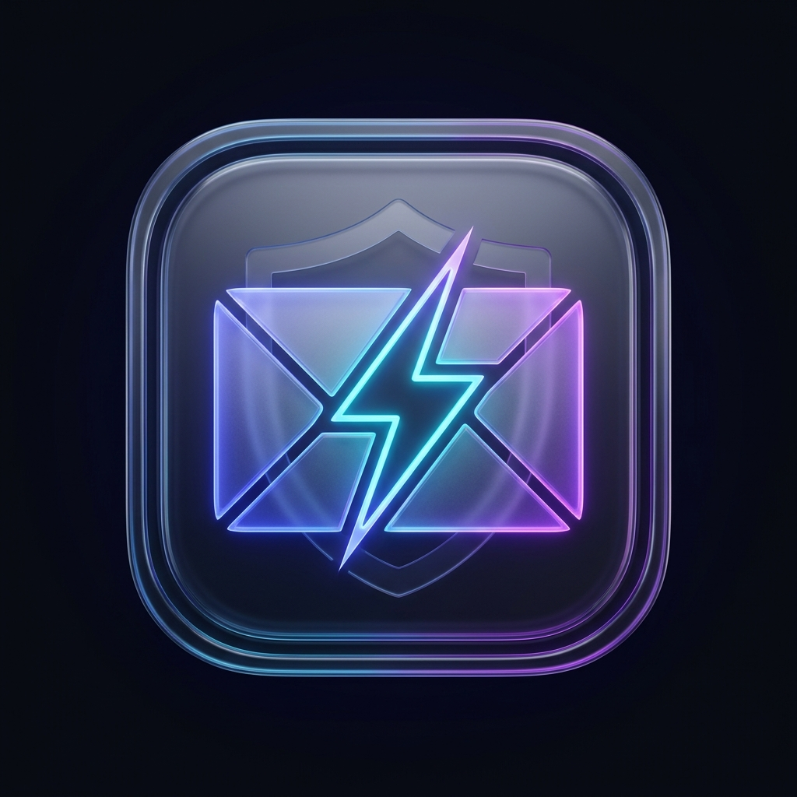

<div align="center">
  
  <h1>Owntemp (v2.8.1) 🛡️</h1>
  <p><b>জীবনব্যাপী সুরক্ষিত কাস্টম ডোমেইন ডিসপোজেবল ইমেইল ও ওটিপি ইঞ্জিন</b></p>
  <p><i>Lifetime Permanent Disposable Temp Mail Engine with Neon Postgres, Supabase Auth & Multi-Platform Delivery</i></p>

  <p>
    <a href="https://github.com/sajjadhossan/owntempmail/releases"></a>
    <a href="https://sim-cooler-mitsubishi-kits.trycloudflare.com"></a>
    <a href="https://owntempmail.vercel.app"></a>
    
    
  </p>
</div>

---

## 🌐 সকল লাইভ লিংক হাব (All Official & Live Project URLs)

সকল প্রয়োজনীয় সিস্টেম লিংক সরাসরি এই প্রজেক্টের ভেতরে এক জায়গায় সংরক্ষিত:

| সার্ভিস | লাইভ লিংক (Live URL) | বিবরণ ও স্ট্যাটাস |
| :--- | :--- | :--- |
| ⚡ **Cloudflare লাইভ অ্যাপ** | [https://sim-cooler-mitsubishi-kits.trycloudflare.com](https://sim-cooler-mitsubishi-kits.trycloudflare.com) | দ্রুততম লাইভ টানেল লিংক (SSL এনক্রিপ্টেড) |
| ☁️ **Vercel প্রোডাকশন লিংক** | [https://owntempmail.vercel.app](https://owntempmail.vercel.app) | ভার্সেল এজ সার্ভারলেস ওয়েবসাইট |
| 📦 **GitHub রিলিজ ও অ্যাসেট** | [https://github.com/sajjadhossan/owntempmail/releases](https://github.com/sajjadhossan/owntempmail/releases) | সরাসরি সব প্ল্যাটফর্মের ইনস্টলার ও APK ফাইল |
| ⚡ **Supabase ডাটাবেস এন্ডপয়েন্ট** | `https://pwalrxmybjgqldzcfozk.supabase.co` | অথ ও ক্লাউড সিঙ্ক ব্যাকএন্ড |
| 🐘 **Neon Serverless Postgres** | `ep-rapid-recipe-aoa945op-pooler.c-2.ap-southeast-1.aws.neon.tech` | ইউজার ও অ্যাকাউন্ট স্টোরেজ |

---

## 📥 সরাসরি ১-ক্লিক রিলিজ অ্যাসেট ডাউনলোড হাব (GitHub Release Assets)

অন্য কোথাও খোঁজাখুঁজি না করে **GitHub Releases -> Assets** থেকে সরাসরি ১-ক্লিকে প্রতিটি প্ল্যাটফর্মের আসল ফাইল ডাউনলোড করুন:

| প্ল্যাটফর্ম | টার্গেট ও আসল ফরম্যাট | সরাসরি ডাউনলোড লিংক (Direct Assets Download) |
| :--- | :--- | :--- |
| 📱 **Android Mobile** | Android 8.0 – 15.0 (.apk) | [📥 `app-v2.8.1-build41-android.apk` (সরাসরি APK)](https://github.com/sajjadhossan/owntempmail/releases/download/v2.8.1/app-v2.8.1-build41-android.apk) |
| 💻 **Windows PC** | 64-bit Windows (.exe Setup) | [📥 `Owntemp-v2.8.1-windows-x64.exe` (সরাসরি EXE)](https://github.com/sajjadhossan/owntempmail/releases/download/v2.8.1/Owntemp-v2.8.1-windows-x64.exe) |
| 🍏 **MacBook Universal** | Intel + Apple Silicon M-Series (.dmg) | [📥 `Owntemp-v2.8.1-macOS-Universal.dmg` (সরাসরি DMG)](https://github.com/sajjadhossan/owntempmail/releases/download/v2.8.1/Owntemp-v2.8.1-macOS-Universal.dmg) |
| ☁️ **Web Standalone** | Node.js Serverless Tarball | [📥 `Owntemp-v2.8.1-web-standalone.tar.gz`](https://github.com/sajjadhossan/owntempmail/releases/download/v2.8.1/Owntemp-v2.8.1-web-standalone.tar.gz) |

> 💡 **নোট:** GitHub Releases পেজে গেলে প্রতিটি রিলিজের নিচে থাকা **"Assets"** ড্রপডাউনে এই ফাইলগুলো সরাসরি পাবেন।

---

## 🌟 মূল ফিচারসমূহ (Core Features)

1. **সুরক্ষিত লগইন গেট ও সুপার অ্যাডমিন ডেস্ক (👑 Super Admin Approval Desk):**
   * সাধারণ যেকোনো ব্যবহারকারী সাইন আপ করলে অ্যাকাউন্ট `pending` থাকে এবং লগইন ব্লক থাকে।
   * সুপার অ্যাডমিন (`hossansajjad1994@gmail.com`) লগইন করলে টপ বারে গোল্ডেন ক্রাউন বাটন পায় এবং ১-ক্লিকে ব্যবহারকারীকে **Approve ✅**, **Reject ❌** অথবা **Delete 🗑️** করতে পারে।
2. **লাইভ গ্লোবাল ইমেইল কালেকশন (৫০,০০০+ ডোমেন ফ্লিট):**
   * নিজস্ব কোনো ডোমেন ছাড়াই `sharklasers.com`, `grr.la`, `fldubai.com`, `guerrillamail.com` ইত্যাদিতে যেকোনো ইউজারনেম দিয়ে আসল ওটিপি ও ইমেইল রিসিভ করার সুবিধা।
3. **লাইফটাইম পিন লক সুরক্ষা (Lifetime Lock Protection):**
   * ৪-ডিজিট পিন কোড সেট করে পছন্দের ইনবক্স চিরতরে নিজের করে রাখা যায়, যা স্বয়ংক্রিয় ক্লিনআপে কখনো মুছে যায় না।
4. **স্মার্ট ওটিপি এক্সট্রাক্টর ও ভয়েস নোটিফিকেশন:**
   * ইনকামিং ইমেইল থেকে ৪-৮ ডিজিটের ওটিপি স্বয়ংক্রিয়ভাবে ডিটেক্ট করে চিপে প্রদর্শন এবং বাংলা ও ইংরেজিতে টেক্সট-টু-স্পিচ ভয়েস অ্যানাউন্সমেন্ট।
5. **অ্যান্ড্রয়েড কাঁপাকাপি মুক্ত মসৃণ টাচ স্ক্রোলিং:**
   * `SwipeRefreshLayout` এবং `WebView`-এর টাচ কনফ্লিক্ট দূর করে ১২০ হার্জ আল্ট্রা-স্মুথ স্ক্রোলিং নিশ্চিত করা হয়েছে।
6. **মডাল ওভারল্যাপ প্রতিরোধ:**
   * সেটিংস, অথ, রিকভার ও ওটিপি ব্যানারের মধ্যে সুনির্দিষ্ট z-index ও স্মার্ট ট্রানজিশন ব্যবস্থাপনা।

---

## 🛠️ লোকাল ডেভেলপমেন্ট ও সার্ভার পরিচালনা

```bash
# ১. ডিপেনডেন্সি ইনস্টল
pnpm install

# ২. লোকাল প্রোডাকশন বিল্ড
pnpm build

# ৩. লোকাল সার্ভার রান
pnpm start -p 3847
```

---

## 📄 লাইসেন্স
MIT License — © 2026 Owntemp Project.
